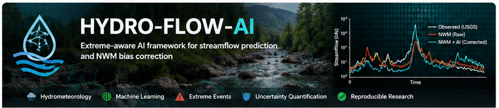
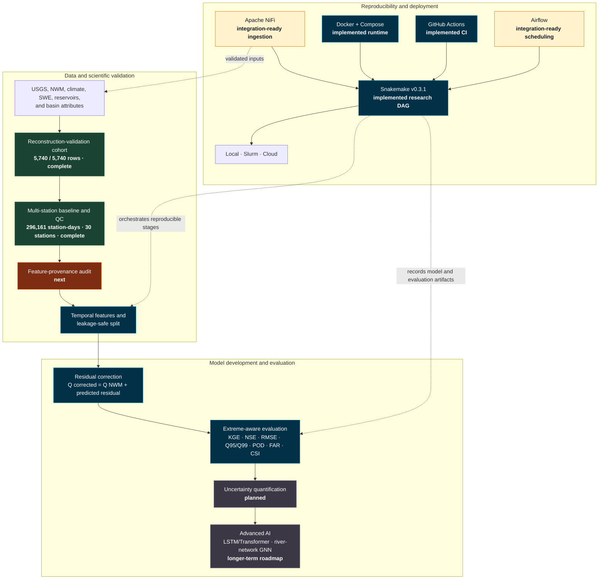

<p align="center">
  
  
</p>

<h1 align="center">HYDRO-FLOW-AI</h1>

<p align="center"><strong>Physics-guided streamflow correction, reproducible workflows, and evidence-linked hydrological diagnostics.</strong></p>

<p align="center">
  <a href="https://github.com/mtariqi/HYDRO-FLOW-AI"></a>
  
  
  
  
  
</p>

<p align="center">
  <a href="https://github.com/mtariqi/HYDRO-FLOW-AI/actions"></a>
  <a href="https://github.com/mtariqi/HYDRO-FLOW-AI/issues"></a>
  
  
  
</p>

---

## Overview

HYDRO-FLOW-AI is a research platform for diagnosing and correcting weak
streamflow estimates from the U.S. National Water Model (NWM). The current
v0.3.1 release learns a residual correction around an NWM-like physical
forecast, evaluates performance by station and flow event, and converts model
results into traceable evidence records for station-specific diagnostics.

The platform separates four concerns:

1. **Data movement and provenance** — Apache NiFi integration design for
   ingestion, validation, routing, back-pressure, and lineage.
2. **Reproducible research execution** — Snakemake rules for data generation,
   training, evaluation, evidence indexing, and diagnostic reporting.
3. **Forecast correction** — physics-guided machine learning that estimates
   the residual error around an NWM baseline.
4. **Evidence-grounded interpretation** — a graph-RAG-compatible evidence
   layer and FastAPI endpoints for station diagnostics.

> **Research status:** v0.3.1 validates the software workflow with synthetic
> data. It does not yet demonstrate improvement on operational NWM forecasts
> and must not be used as an official flood-warning system.

## Research question

> Can regime-aware, physics-guided machine learning improve weak NWM
> streamflow estimates while preserving temporal validity, hydrological
> interpretability, event-detection performance, and reproducibility?

## Capability status

| Component | Status | Notes |
|---|---|---|
| Synthetic hydrological generator | Implemented | Runs without external credentials |
| Residual ML correction | Implemented | Histogram gradient boosting around NWM-like flow |
| Chronological splitting | Implemented | 70% training, 15% validation, 15% test |
| Station and event metrics | Implemented | KGE, NSE, RMSE, MAE, bias, CSI and detection metrics |
| Snakemake workflow | Implemented | Local and Slurm profiles |
| Evidence graph | Implemented | Deterministic offline retrieval baseline |
| Station-constrained diagnosis | Implemented | Prevents cross-station evidence contamination |
| FastAPI service | Implemented | Prediction, health and diagnostic endpoints |
| Docker and Compose | Implemented | Reproducible API packaging |
| GitHub Actions | Implemented | Linting, tests and smoke workflow |
| Apache NiFi | Integration-ready | Intended for continuous ingestion and provenance |
| Airflow | Integration-ready | Outer scheduling of batch retraining |
| Real USGS/NWM pilot | Planned | Requires issue-time-aligned source data |
| Multi-horizon forecasting | Planned | 15 minutes to 24 hours |
| Quantile uncertainty | Planned | P05/P50/P95 and calibration |
| River-network GNN | Planned | Travel-time-aware upstream/downstream learning |

## Architecture



The research stages and the platform layer intentionally have different status
labels. The real-data cohorts and quality-control results are not outputs of the
synthetic v0.3.1 demonstration, while the Snakemake/Docker/CI implementation is
the reproducible software foundation used to extend that research safely.

### Separation of responsibilities

| Technology | Responsibility |
|---|---|
| Apache NiFi | Continuous collection, routing, schema checks, provenance, replay and back-pressure |
| Snakemake | File-based scientific dependency graph and reproducible execution |
| Airflow | Scheduled triggering and outer workflow coordination |
| Docker | Portable runtime for the API and repeatable deployments |
| GitHub Actions | Automated linting, testing and smoke validation |
| FastAPI | Online prediction and station-diagnostic interface |
| Graph-RAG layer | Links stations, experiments, metrics, documents and evidence |

NiFi is not used to train models, and Snakemake is not used as a streaming
engine. This boundary keeps the analytical workflow testable and the ingestion
layer operationally manageable.

## Snakemake v0.3.1 workflow

The validated workflow executes six dependency-aware steps:

```text
make_demo
    └── train
          └── evaluate
                └── build_knowledge
                      └── diagnose_station
                            └── all
```

Run it locally:

```bash
python -m venv .venv
source .venv/bin/activate
pip install -e ".[dev,api,workflow]"

snakemake \
  --snakefile workflow/Snakefile \
  --workflow-profile workflow/profiles/local \
  --cores 8 \
  --dry-run

snakemake \
  --snakefile workflow/Snakefile \
  --workflow-profile workflow/profiles/local \
  --cores 8
```

Expected outputs:

```text
data/demo.csv
artifacts/residual_corrector.joblib
artifacts/training_summary.json
artifacts/evaluation.json
artifacts/test_predictions.csv
artifacts/evidence_graph.json
reports/diagnostic_S000.txt
```

An unchanged repeat run should report:

```text
Nothing to be done (all requested files are present and up to date).
```

See [workflow/README.md](workflow/README.md) for local and Slurm execution.

## Current model

The v0.3.1 baseline estimates the residual between observed discharge and the
physical forecast:

$$
e_t = Q_{\mathrm{obs},t} - Q_{\mathrm{NWM},t}
$$

The histogram-gradient-boosting model learns the conditional residual from the
predictor vector $\mathbf{X}_t$:

$$
\widehat{e}_t = f_{\boldsymbol{\theta}}(\mathbf{X}_t).
$$

The final non-negative discharge estimate is

$$
\widehat{Q}_{\mathrm{corrected},t}
= \max\!\left(0,\;Q_{\mathrm{NWM},t}+\widehat{e}_t\right).
$$

Features include NWM-like flow, precipitation, temperature, soil moisture,
snow-water equivalent, reservoir-storage change, recent residuals, upstream
flow context, basin attributes, regulation status, and cyclical seasonality.

Day of year is encoded without an artificial discontinuity between December
and January:

$$
\mathrm{DOY}_{\sin,t}=\sin\!\left(\frac{2\pi\,\mathrm{DOY}_t}{365.25}\right),
\qquad
\mathrm{DOY}_{\cos,t}=\cos\!\left(\frac{2\pi\,\mathrm{DOY}_t}{365.25}\right).
$$

High-flow observations receive additional training weight. The current model is
a same-time residual-correction baseline; multi-horizon targets are future work.

## Evaluation

The workflow reports KGE, NSE, RMSE, MAE, percent bias, bias ratio, variability
ratio, correlation, critical success index, probability of detection,
false-alarm ratio, station-level KGE change, failure-cohort recovery, and
degradation counts for initially strong stations.

For $n$ observations $Q_i$ and predictions $\widehat{Q}_i$, the principal
continuous metrics are

$$
\mathrm{RMSE}=\sqrt{\frac{1}{n}\sum_{i=1}^{n}
\left(\widehat{Q}_i-Q_i\right)^2},
\qquad
\mathrm{MAE}=\frac{1}{n}\sum_{i=1}^{n}\left|\widehat{Q}_i-Q_i\right|,
$$

$$
\mathrm{PBIAS}=100\,
\frac{\sum_{i=1}^{n}\left(\widehat{Q}_i-Q_i\right)}
{\sum_{i=1}^{n}Q_i},
$$

$$
\mathrm{NSE}=1-
\frac{\sum_{i=1}^{n}\left(Q_i-\widehat{Q}_i\right)^2}
{\sum_{i=1}^{n}\left(Q_i-\overline{Q}\right)^2},
$$

and

$$
\mathrm{KGE}=1-\sqrt{(r-1)^2+(\alpha-1)^2+(\beta-1)^2},
$$

where $r$ is the observed–predicted correlation,
$\alpha=\sigma_{\widehat{Q}}/\sigma_Q$ is the variability ratio, and
$\beta=\mu_{\widehat{Q}}/\mu_Q$ is the bias ratio.

For high-flow event detection, with hits $H$, misses $M$, and false alarms
$F$, the workflow reports

$$
\mathrm{POD}=\frac{H}{H+M},
\qquad
\mathrm{FAR}=\frac{F}{H+F},
\qquad
\mathrm{CSI}=\frac{H}{H+M+F}.
$$

### Synthetic verification result

One validated v0.3.1 run produced:

| Measure | Result |
|---|---:|
| Stations evaluated | 12 |
| Negative-KGE stations | 2 |
| Negative-KGE stations moved above zero | 2 |
| Negative-KGE stations moved above KGE 0.5 | 2 |
| Median station-level ΔKGE | +0.373 |
| Initially strong stations degraded | 0 |
| Pooled validation KGE | 0.474 → 0.935 |
| Validation RMSE | 2.243 → 0.684 |

These values validate pipeline behavior only. Synthetic relationships are more
regular than operational hydrology and cannot establish real-world skill.

## Previous graph-ML and Kafka research

Earlier HYDRO-FLOW-AI experiments investigated river-network-aware machine
learning and Kafka-assisted streaming analysis. These experiments remain
scientifically relevant because they established an architectural foundation
for representing upstream–downstream dependencies and transporting
high-frequency hydrological events.

They are retained as a distinct research track. The current v0.3.1 release
reproduces the Snakemake-orchestrated residual-correction baseline and the
deterministic evidence graph; it does not yet reproduce every earlier graph-ML
or Kafka result. Those findings should therefore be reported with their
original datasets, temporal splits, model configurations, checkpoints, metric
definitions, and software versions.

The components serve different purposes:

| Component | Primary responsibility | Current status |
|---|---|---|
| River-network graph ML | Learn predictive upstream–downstream dependencies | Previous experimental track |
| Evidence graph / Graph-RAG | Retrieve source-linked station and experiment evidence | Implemented deterministic baseline |
| Apache Kafka | Transport high-frequency event messages | Previous streaming prototype |
| Apache NiFi | Ingest, validate, route, trace and replay source data | Integration-ready |
| Snakemake | Reproduce file-based scientific analyses | Implemented |

Graph-ML predictive results must not be pooled with the synthetic v0.3.1
verification statistics unless both are regenerated under the same documented
evaluation protocol.

## Planned uncertainty outputs

Future multi-horizon models will estimate conditional quantiles
$\widehat{Q}^{(\tau)}_{t+h}$ and calibrated prediction intervals. The intended
extreme-event output is the probability of exceeding a decision threshold,

$$
\Pr\!\left(Q_{t+h}>Q_{\mathrm{critical}}\mid\mathbf{X}_t\right),
$$

rather than only a single deterministic discharge estimate. Coverage,
sharpness, calibration, and threshold reliability will be assessed separately
from point-prediction accuracy.

## Graph-RAG diagnostics

The evidence layer connects gauges, catchments, NWM reaches, dataset versions,
model runs, features, metrics, modelling decisions, and diagnostic reports.

```bash
hydroflow build-knowledge --artifacts artifacts
hydroflow diagnose --artifacts artifacts --station S000
```

Station diagnosis uses an exact station-entity constraint. A report for S000
cannot retrieve S001 merely because both records contain terms such as “KGE” or
“NWM.” Every statement includes its evidence identifier and source.

## Apache NiFi integration

NiFi is the proposed operational ingestion layer for USGS observations, NWM
forecast vintages, meteorological forecasts, SNOTEL snow-water equivalent,
reservoir operations, and station/catchment metadata.

```text
Fetch or receive data
    → attach source and issue-time metadata
    → validate schema and freshness
    → reject duplicates
    → quarantine invalid records
    → retain an immutable raw copy
    → publish validated data for Snakemake
```

NiFi deployment is optional in v0.3.1. The synthetic workflow remains fully
runnable without it.

## Docker

```bash
docker build -t hydro-flow-ai:0.3.1 .
docker compose up --build
```

Open `http://localhost:8000/docs`. API output is research guidance, not an
official forecast or warning.

## Real-data research foundation

The broader repository contains two complementary real-data scopes.

### Validated reconstruction cohort

- 5,740 daily observations;
- two Utah USGS gauges;
- 2012–2019;
- one-to-one date reconstruction independently validated;
- intended to establish a leakage-aware temporal modelling workflow.

| NWIS site | Station |
|---|---|
| `10133800` | East Canyon Creek near Jeremy Ranch, Utah |
| `10133600` | McLeod Creek near Park City, Utah |

### Multi-station NWM evaluation cohort

- 296,161 station-day observations;
- 30 USGS stations;
- approximately 1990–2020, depending on station availability;
- intended for raw NWM baselines, high-flow diagnostics, scale-anomaly
  screening and eligibility assessment.

Five stations are currently flagged for scientific review before pooled
modelling. A flag does not establish that a station is erroneous; unresolved
stations remain outside the model-eligible cohort.

## Leakage controls

- Use chronological or event-based splitting.
- Keep complete storms within one split.
- Use only forecast vintages available at issue time.
- Fit scalers and imputers using training data only.
- Prevent lagged observations from crossing the forecast issue time.
- Incorporate realistic upstream travel times.
- Derive event thresholds from training data or official thresholds.
- Evaluate unseen basins and extreme periods.

## Repository structure

```text
HYDRO-FLOW-AI/
├── .github/workflows/ci.yml
├── configs/
├── dags/hydroflow_pipeline.py
├── docs/
├── knowledge/
├── src/
│   ├── hydro_flow_ai/          # original reconstruction package
│   └── hydroflow_ai/           # v0.3.1 correction/diagnostic package
├── tests/
├── workflow/
│   ├── Snakefile
│   ├── envs/
│   └── profiles/
├── Dockerfile
├── docker-compose.yml
├── Makefile
└── pyproject.toml
```

Generated data, models, reports, Snakemake state, and virtual environments are
excluded from version control.

## Direct CLI use

```bash
hydroflow make-demo --output data/demo.csv
hydroflow train --data data/demo.csv --output artifacts
hydroflow evaluate --data data/demo.csv --artifacts artifacts
hydroflow build-knowledge --artifacts artifacts
hydroflow diagnose --artifacts artifacts --station S000
hydroflow serve --artifacts artifacts
hydroflow smoke
```

## Reproducibility principles

- Configuration is separated from code.
- Intermediate artifacts are explicit workflow products.
- Chronological splits replace random row splitting.
- Dependencies are declared in `pyproject.toml`.
- Docker provides a portable runtime.
- CI executes linting, tests, and a smoke workflow.
- Diagnostics include evidence identifiers and sources.
- Strong stations are monitored for degradation, not only weak stations for gain.

## Roadmap

### v0.4

- issue-time-safe multi-horizon targets from 15 minutes to 24 hours;
- per-station validation summaries and explicit skill classes;
- official or training-derived event thresholds;
- probabilistic quantiles and calibration;
- real USGS/NWM ingestion adapters.

### Later research

- temporal GRU or Temporal Fusion Transformer;
- travel-time-aware river-network GNN;
- adaptive NWM/GBM/GNN gating;
- NiFi deployment and replay testing;
- Airflow champion-challenger scheduling;
- drift and data-freshness monitoring;
- transfer evaluation on unseen basins.

## Documentation

- [Workflow instructions](workflow/README.md)
- [Project plan](docs/PROJECT_PLAN.md)
- [Model card](docs/MODEL_CARD.md)
- [Knowledge graph](docs/KNOWLEDGE_GRAPH.md)
- [References](docs/REFERENCES.md)

## Citation

If you use this research software, cite the repository and the exact release or
commit used. A formal archival citation will be added after an archival release.

## Contributing

Contributions should preserve temporal validity, source provenance,
station-level evaluation, deterministic workflow behavior, and the distinction
between implemented capabilities and future research claims.

## License

MIT License. See [LICENSE](LICENSE).
