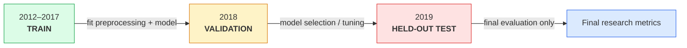
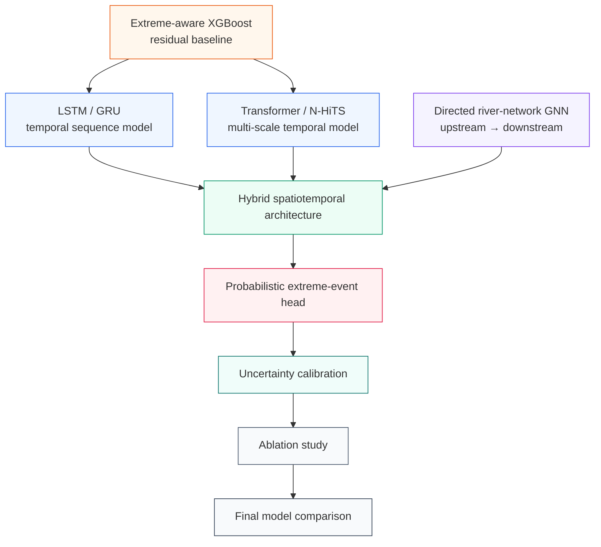

<p align="center">
  
</p>

<h1 align="center">HYDRO-FLOW-AI</h1>

<p align="center"><strong>Physics-guided streamflow correction, reproducible workflows, and evidence-linked hydrological diagnostics.</strong></p>

<p align="center">
  <a href="https://github.com/mtariqi/HYDRO-FLOW-AI"></a>
  
  
  
  
  
</p>

<p align="center">
  <a href="https://github.com/mtariqi/HYDRO-FLOW-AI/actions"></a>
  <a href="https://github.com/mtariqi/HYDRO-FLOW-AI/issues"></a>
  
  
  
</p>

---

## Overview
HYDRO-FLOW-AI is a research platform for diagnosing and correcting weak
streamflow estimates from the U.S. National Water Model (NWM). The current
v0.3.1 release learns a residual correction around an NWM-like physical
forecast, evaluates performance by station and flow event, and converts model
results into traceable evidence records for station-specific diagnostics.

The platform separates four concerns:
1. Data movement and provenance — Apache NiFi integration design for
   ingestion, validation, routing, back-pressure, and lineage.
2. Reproducible research execution — Snakemake rules for data generation,
   training, evaluation, evidence indexing, and diagnostic reporting.
3. Forecast correction — physics-guided machine learning that estimates
   the residual error around an NWM baseline.
4. Evidence-grounded interpretation — a graph-RAG-compatible evidence
   layer and FastAPI endpoints for station diagnostics.
Research status: v0.3.1 validates the software workflow with synthetic
data. It does not yet demonstrate improvement on operational NWM forecasts
and must not be used as an official flood-warning system.

### Research question
> **Can regime-aware, physics-guided machine learning improve weak NWM
streamflow estimates while preserving temporal validity, hydrological
interpretability, event-detection performance, and reproducibility?
**


## Capability status
| Component | Status | Notes |
|---|---|---|
| Synthetic hydrological generator | Implemented | Runs without external credentials |
| Residual ML correction | Implemented | Histogram gradient boosting around NWM-like flow |
| Chronological splitting | Implemented | 70% training, 15% validation, 15% test |
| Station and event metrics | Implemented | KGE, NSE, RMSE, MAE, bias, CSI and detection metrics |
| Snakemake workflow | Implemented | Local and Slurm profiles |
| Evidence graph | Implemented | Deterministic offline retrieval baseline |
| Station-constrained diagnosis | Implemented | Prevents cross-station evidence contamination |
| FastAPI service | Implemented | Prediction, health and diagnostic endpoints |
| Docker and Compose | Implemented | Reproducible API packaging |
| GitHub Actions | Implemented | Linting, tests and smoke workflow |
| Apache NiFi | Integration-ready | Intended for continuous ingestion and provenance |
| Airflow | Integration-ready | Outer scheduling of batch retraining |
| Real USGS/NWM pilot | Planned | Requires issue-time-aligned source data |
| Multi-horizon forecasting | Planned | 15 minutes to 24 hours |
| Quantile uncertainty | Planned | P05/P50/P95 and calibration |
| River-network GNN | Planned | Travel-time-aware upstream/downstream learning |


## Snakemake v0.3.1 workflow

The repository now includes a reproducible Snakemake workflow for synthetic
NWM residual correction, station-level hydrological evaluation, graph-based
evidence indexing, and station-specific diagnostic reporting.

See:

- [Snakemake v0.3.1 guide](docs/SNAKEMAKE_V0.3.1.md)
- [Workflow instructions](workflow/README.md)
- [Model card](docs/MODEL_CARD.md)
- [Research plan](docs/PROJECT_PLAN.md)

Run locally:

```bash
pip install -e ".[dev,api,workflow]"

snakemake \
  --snakefile workflow/Snakefile \
  --workflow-profile workflow/profiles/local \
  --cores 8
## Study sites

The current validated reconstruction uses two USGS gauges in Utah.

| NWIS Site ID | Station                                 |    Latitude |    Longitude |
| ------------ | --------------------------------------- | ----------: | -----------: |
| `10133800`   | East Canyon Creek near Jeremy Ranch, UT | 40.75966979 | -111.5640912 |
| `10133600`   | McLeod Creek near Park City, UT         | 40.68803889 | -111.5337194 |
```
## Architecture
flowchart TD
    A["NWM, USGS, weather, SWE, reservoirs"] --> B["Apache NiFi ingestion"]
    B --> C["Validated raw storage and feature tables"]
    C --> D["Snakemake research workflow"]
    D --> E["Physics-guided residual correction"]
    E --> F["Station and event evaluation"]
    F --> G["Evidence graph and diagnostics"]
    G --> H["FastAPI and reports"]
    I["Docker and GitHub Actions"] --> D
    J["Airflow scheduling"] --> D

### Separation of responsibilities
| Technology | Responsibility |
|---|---|
| Apache NiFi | Continuous collection, routing, schema checks, provenance, replay and back-pressure |
| Snakemake | File-based scientific dependency graph and reproducible execution |
| Airflow | Scheduled triggering and outer workflow coordination |
| Docker | Portable runtime for the API and repeatable deployments |
| GitHub Actions | Automated linting, testing and smoke validation |
| FastAPI | Online prediction and station-diagnostic interface |
| Graph-RAG layer | Links stations, experiments, metrics, documents and evidence |

### Snakemake v0.3.1 workflow
The validated workflow executes six dependency-aware steps:
make_demo
    └── train
          └── evaluate
                └── build_knowledge
                      └── diagnose_station
                            └── all
                            
Run it locally:
python -m venv .venv
source .venv/bin/activate
pip install -e ".[dev,api,workflow]"

snakemake \
  --snakefile workflow/Snakefile \
  --workflow-profile workflow/profiles/local \
  --cores 8 \
  --dry-run

snakemake \
  --snakefile workflow/Snakefile \
  --workflow-profile workflow/profiles/local \
  --cores 8

Expected outputs:
data/demo.csv
artifacts/residual_corrector.joblib
artifacts/training_summary.json
artifacts/evaluation.json
artifacts/test_predictions.csv
artifacts/evidence_graph.json
reports/diagnostic_S000.txt 

An unchanged repeat run should report:
Nothing to be done (all requested files are present and up to date).
See [README.md](workflow/README.md) for local and Slurm execution.
Current model
The v0.3.1 baseline estimates the residual between observed discharge and the
physical forecast:

e_t = Q_{observed,t} - Q_{NWM,t}
\hat{Q}_{corrected,t} = \max(0, Q_{NWM,t} + \hat{e}_t)


Features include NWM-like flow, precipitation, temperature, soil moisture,
snow-water equivalent, reservoir-storage change, recent residuals, upstream
flow context, basin attributes, regulation status, and cyclical seasonality.

High-flow observations receive additional training weight. The current model is
a same-time residual-correction baseline; multi-horizon targets are future work.
Evaluation
The workflow reports KGE, NSE, RMSE, MAE, percent bias, bias ratio, variability
ratio, correlation, critical success index, probability of detection,
false-alarm ratio, station-level KGE change, failure-cohort recovery, and
degradation counts for initially strong stations.
Synthetic verification result
One validated v0.3.1 run produced:

| Measure | Result |
|---|---:|
| Stations evaluated | 12 |
| Negative-KGE stations | 2 |
| Negative-KGE stations moved above zero | 2 |
| Negative-KGE stations moved above KGE 0.5 | 2 |
| Median station-level ΔKGE | +0.373 |
| Initially strong stations degraded | 0 |
| Pooled validation KGE | 0.474 → 0.935 |
| Validation RMSE | 2.243 → 0.684 |

These values validate pipeline behavior only. Synthetic relationships are more
regular than operational hydrology and cannot establish real-world skill.

## Graph-RAG diagnostics
The evidence layer connects gauges, catchments, NWM reaches, dataset versions,
model runs, features, metrics, modelling decisions, and diagnostic reports.

hydroflow build-knowledge --artifacts artifacts
hydroflow diagnose --artifacts artifacts --station S000

Station diagnosis uses an exact station-entity constraint. A report for S000
cannot retrieve S001 merely because both records contain terms such as “KGE” or
“NWM.” Every statement includes its evidence identifier and source.

## Apache NiFi integration

NiFi is the proposed operational ingestion layer for USGS observations, NWM
forecast vintages, meteorological forecasts, SNOTEL snow-water equivalent,
reservoir operations, and station/catchment metadata.

Fetch or receive data
    → attach source and issue-time metadata
    → validate schema and freshness
    → reject duplicates
    → quarantine invalid records
    → retain an immutable raw copy
    → publish validated data for Snakemake

### Dataset scopes

HYDRO-FLOW-AI currently uses two complementary dataset scopes.

**Validated reconstruction dataset**
- 5,740 daily observations
- 2 USGS gauges
- 2012–2019
- one-to-one date reconstruction independently validated
- used to establish the reproducible temporal modeling workflow

**Multi-station NWM evaluation dataset**
- 296,161 station-day observations
- 30 USGS stations
- approximately 1990–2020, depending on station availability
- used for raw NWM baseline evaluation, high-flow diagnostics,
  scale-anomaly screening, and station eligibility assessment

The multi-station QC workflow currently identifies 5 stations requiring
review before pooled machine-learning experiments. Stations flagged by
the automated screen are not assumed to be erroneous; they are withheld
from pooled modeling until their NWM–USGS relationship has been
scientifically adjudicated.


```

## Stage 1 — Dataset reconstruction ✅

The original ML export, `NWM_ML_Training_DF.csv`, retained hydrologic and environmental variables but removed `datetime` and `NWIS_site_id`.

`src/hydro_flow_ai/reconstruct_dataset.py` restores those fields reproducibly.

### Reconstruction logic

1. Assign each training row to an NWIS gauge using retained latitude/longitude.
2. Reconstruct a dated reference table from:

   * `Climate.csv`
   * observed USGS streamflow in `flow.pkl`
3. Restrict candidate dates to the same:

   * NWIS site;
   * day-of-year.
4. Match:

   * temperature;
   * precipitation;
   * observed streamflow.
5. Use an absolute numeric tolerance:

```text
--match-atol 1e-5
```

6. Require exactly **one** valid date for every original training row.
7. Reject zero-match or multi-match cases instead of silently guessing.
8. Validate uniqueness of `(NWIS_site_id, datetime)`.

### Validated result

```text
- 296,161 daily station records
- 30 USGS stations
- Utah and Idaho
- 1990-01-01 through 2020-09-30 overall
- observed USGS discharge (`flow_cms`)
- raw NWM discharge (`NWM_flow`)
- precipitation and temperature
- storage and snow-water equivalent
- static basin and land-cover attributes
```

Run:

```fish
python src/hydro_flow_ai/reconstruct_dataset.py
```

---

## Stage 2 — Temporal feature engineering 🚧

The next stage converts the dated dataset into a leakage-safe temporal feature matrix.

### NWM flow features

```text
NWM_flow_t
NWM_flow_lag1
NWM_flow_lag3
NWM_flow_lag7
```

### Antecedent precipitation

```text
precip_1d
precip_3d
precip_7d
precip_14d
```

The multi-day precipitation features are intended to represent antecedent watershed forcing rather than only same-day rainfall.

### Temperature features

```text
temperature_t
temperature_lag1
temperature_lag3
temperature_lag7
```

### Seasonal encoding

Day-of-year is represented cyclically:

[
DOY_{\sin} =
\sin\left(\frac{2\pi,DOY}{365.25}\right)
]

[
DOY_{\cos} =
\cos\left(\frac{2\pi,DOY}{365.25}\right)
]

### Static watershed features

Current variables include:

* drainage area;
* mean basin elevation;
* percentage forest cover;
* percentage developed land;
* percentage impervious surface;
* percentage herbaceous cover;
* percentage steep slope;
* mean annual precipitation.

---

## Leakage-safe experiment design

A random split is intentionally avoided because adjacent daily observations are temporally autocorrelated.



This design protects the final reported performance from temporal leakage and repeated access to the test period.

---

## Stage 3 — Residual-correction baseline

The initial machine-learning baseline is **XGBoost residual correction**.

The target is:

[
e_t =
Q^{obs}_t - Q^{NWM}_t
]

The model learns:

[
\hat e_t = f_{\theta}(X_t)
]

The corrected prediction becomes:

[
\hat Q^{corrected}_t =
Q^{NWM}_t + \hat e_t
]

This preserves the NWM prediction as the reference hydrologic estimate while allowing ML to learn systematic local error.

---

# Extreme-aware evaluation

Average performance alone can conceal severe errors during rare high-flow events.

HYDRO-FLOW-AI therefore separates conventional metrics from extreme-flow metrics.

## Standard metrics

| Metric | Purpose                                                |
| ------ | ------------------------------------------------------ |
| RMSE   | penalizes large prediction errors                      |
| MAE    | average absolute prediction error                      |
| Bias   | systematic over- or underprediction                    |
| NSE    | hydrologic predictive efficiency                       |
| KGE    | combined correlation, variability, and bias assessment |

## Extreme-focused metrics

| Metric               | Purpose                                        |
| -------------------- | ---------------------------------------------- |
| Q95 RMSE             | error above the 95th-percentile flow threshold |
| Q99 RMSE             | error in the most extreme tail                 |
| Peak magnitude error | accuracy of maximum discharge                  |
| Peak timing error    | timing displacement of observed peaks          |
| POD                  | probability of detection                       |
| FAR                  | false-alarm ratio                              |
| CSI                  | critical success index                         |
| Precision / Recall   | class-imbalance-aware event detection          |

---

# Uncertainty quantification

Future deterministic predictions will be extended with uncertainty-aware outputs.

Planned methods include:

* quantile regression;
* calibrated prediction intervals;
* conformal prediction;
* interval coverage;
* interval sharpness;
* reliability analysis;
* probability of threshold exceedance.

The eventual extreme-event prediction target is:

[
P(Q_{t+h} > Q_{critical})
]

rather than only a single deterministic discharge value.

---

# Advanced AI roadmap



---

# Repository structure
```text
HYDRO-FLOW-AI/
├── README.md
├── LICENSE
├── pyproject.toml
├── requirements.txt
├── .gitignore
├── .pre-commit-config.yaml
│
├── configs/
│   ├── data.yaml
│   ├── features.yaml
│   ├── baseline_xgb.yaml
│   ├── extremes.yaml
│   └── uncertainty.yaml
│
├── data/
│   ├── raw/
│   │   └── .gitkeep
│   ├── interim/
│   │   └── .gitkeep
│   ├── processed/
│   │   └── .gitkeep
│   └── derived/
│       └── .gitkeep
│
├── docs/
│   ├── methodology.md
│   ├── data_dictionary.md
│   ├── reproducibility.md
│   └── assets/
│       └── HYDRO-FLOW-AI-banner.png
│
├── notebooks/
│   ├── 01_data_audit.ipynb
│   ├── 02_extreme_flow_analysis.ipynb
│   ├── 03_feature_diagnostics.ipynb
│   └── 04_model_comparison.ipynb
│
├── models/
│   └── .gitkeep
│
├── results/
│   ├── figures/
│   │   └── .gitkeep
│   ├── metrics/
│   │   └── .gitkeep
│   └── tables/
│       └── .gitkeep
│
├── src/
│   └── hydro_flow_ai/
│       ├── __init__.py
│       │
│       ├── data/
│       │   ├── __init__.py
│       │   ├── reconstruct_dataset.py
│       │   ├── validate.py
│       │   └── io.py
│       │
│       ├── features/
│       │   ├── __init__.py
│       │   ├── temporal.py
│       │   ├── precipitation.py
│       │   ├── seasonality.py
│       │   └── build_features.py
│       │
│       ├── modeling/
│       │   ├── __init__.py
│       │   ├── baseline.py
│       │   ├── xgboost_model.py
│       │   ├── train.py
│       │   └── predict.py
│       │
│       ├── evaluation/
│       │   ├── __init__.py
│       │   ├── metrics.py
│       │   ├── extremes.py
│       │   ├── peaks.py
│       │   └── evaluate.py
│       │
│       ├── uncertainty/
│       │   ├── __init__.py
│       │   ├── quantiles.py
│       │   └── conformal.py
│       │
│       ├── advanced/
│       │   ├── __init__.py
│       │   ├── lstm.py
│       │   ├── transformer.py
│       │   └── river_gnn.py
│       │
│       ├── split.py
│       └── utils.py
│
├── tests/
│   ├── test_reconstruction.py
│   ├── test_features.py
│   ├── test_split.py
│   ├── test_metrics.py
│   └── test_extremes.py
│
└── .github/
    └── workflows/
        └── ci.yml
```
```text
Google Drive — collaborative/source data
        │
        ├── NWM data
        ├── USGS streamflow
        ├── climate data
        ├── site/basin data
        └── collaborator-provided datasets
                │
                ▼
Local HYDRO-FLOW-AI/data/
        │
        ├── raw/          ← downloaded source data
        ├── interim/      ← intermediate transformations
        ├── processed/    ← cleaned datasets
        └── derived/      ← ML-ready datasets
                │
                ▼
GitHub — code + documentation only
```
# Data Sources

HYDRO-FLOW-AI integrates hydrologic, meteorological, and watershed
information from multiple sources.

## Data provenance

| Source | Data | Role |
|---|---|---|
| USGS NWIS | Observed streamflow | Ground-truth discharge |
| National Water Model (NWM) | Simulated streamflow | Baseline/model input |
| Climate forcing | Temperature and precipitation | Meteorological predictors |
| Basin/site attributes | Watershed characteristics | Static predictors |
| Collaborative research data | Project-specific hydrologic datasets | Model development and validation |

## Collaborative data

Additional project datasets are maintained in a shared Google Drive
workspace used by the research collaborators.

These source datasets are intentionally excluded from the public GitHub
repository. The repository contains the processing, reconstruction,
feature-engineering, modeling, and evaluation code required for the
HYDRO-FLOW-AI workflow.

## Current study sites

- USGS NWIS 10133800
- USGS NWIS 10133600

Study period: 2012–2019.
---

# Quick start

## 1. Clone the repository

```bash
git clone https://github.com/mtariqi/HYDRO-FLOW-AI.git
cd HYDRO-FLOW-AI
```

## 2. Create a virtual environment

### Bash / Zsh

```bash
python3 -m venv .venv
source .venv/bin/activate
```

### Fish

```fish
python3 -m venv .venv
source .venv/bin/activate.fish
```

## 3. Install dependencies

```bash
python -m pip install --upgrade pip
pip install -r requirements.txt
```

## 4. Add source data locally

Large source and derived datasets are intentionally excluded from Git.

Place or link the required input files according to the local project configuration before running the reconstruction pipeline.

## 5. Run dataset reconstruction

```bash
python src/hydro_flow_ai/reconstruct_dataset.py
```

Expected validation:

```text
Original training rows : 5740
Unique matched rows    : 5740
Problem row IDs        : 0
```

---

# Reproducibility principles

HYDRO-FLOW-AI follows several methodological constraints:

* no random temporal split for the primary experiment;
* no future information in predictor construction;
* an untouched final test period;
* standard and extreme-flow metrics reported separately;
* failed reconstruction is explicit rather than silently corrected;
* derived datasets are reproducibly generated;
* large data and model artifacts remain outside source control;
* raw NWM performance is retained as a comparison baseline;
* feature and architecture additions are evaluated using ablation studies;
* uncertainty calibration is treated separately from point-prediction accuracy.

---

# Data management

Large hydrologic inputs and derived datasets are not stored directly in the GitHub repository.

The repository tracks:

* source code;
* configuration;
* documentation;
* reproducible processing logic;
* tests;
* lightweight research outputs.

Data directories are retained structurally with `.gitkeep` files while substantive datasets remain gitignored.

---

# Collaborator

**Mohammad Shahabul Alam, PhD**
Assistant Professor, University of West Florida

* GitHub: [shahab122](https://github.com/shahab122)
* LinkedIn: [Mohammad Shahabul Alam](https://www.linkedin.com/in/md-shahabul-alam/)

---

# Upstream reference

This project extends ideas and data-processing workflows from the Alabama Water Institute **NWM-ML** project.

HYDRO-FLOW-AI is maintained as an independent research repository focused on:

* extreme-flow NWM bias correction;
* leakage-safe temporal modeling;
* extreme-event evaluation;
* uncertainty quantification;
* probabilistic threshold prediction;
* temporal deep learning;
* future river-network graph learning.

Where upstream code, data-processing workflows, or methodological components are reused or adapted, the original project should be appropriately acknowledged and cited.

---

# Project status

| Component | Status |
| --- | --- |
| Repository architecture | ✅ Complete |
| Dataset reconstruction | ✅ Complete |
| 5,740-row one-to-one date validation | ✅ Complete |
| Site/date duplicate validation | ✅ Complete |
| Raw NWM baseline evaluation | ✅ Complete |
| Station-specific Q95/Q99 evaluation | ✅ Complete |
| Automated NWM scale-anomaly screening | ✅ Complete |
| Scientific adjudication registry | ✅ Complete |
| Station-level forensic audit utility | ✅ Complete |
| QC test suite | ✅ Complete — 14 tests passing |
| Multi-station collaborator dataset integration | ✅ Complete |
| Feature provenance audit | ⏭️ Next |
| Temporal feature engineering | ⏳ Planned |
| Leakage-safe train/validation/test split | ⏳ Planned |
| XGBoost residual correction baseline | ⏳ Planned |
| Extreme-event evaluation | ⏳ Planned |
| Uncertainty quantification | ⏳ Planned |
| Temporal deep learning | 🔬 Research roadmap |
| River-network GNN | 🔬 Research roadmap |
---

# Technology stack

<p>
  
  
  
  
  
  
  
  
</p>

---

# Citation

A formal software citation and versioned release will be added when the first stable research release is published.

Until then, please cite:

```text
HYDRO-FLOW-AI
https://github.com/mtariqi/HYDRO-FLOW-AI
```

and acknowledge the upstream NWM-ML project when its workflows or source components materially contribute to the analysis.

---

# Contributing

Reproducibility checks, hydrology-domain feedback, feature suggestions, model comparisons, and issue reports are welcome.

For substantial changes, please open an issue describing:

1. the hydrologic or machine-learning problem;
2. the proposed change;
3. expected validation criteria;
4. implications for temporal leakage;
5. implications for extreme-event evaluation;
6. implications for uncertainty or calibration.

---

<p align="center">
  <strong>HYDRO-FLOW-AI</strong><br>
  Better average predictions are useful.<br>
  <strong>Better extreme-event predictions are the objective.</strong>
</p>
