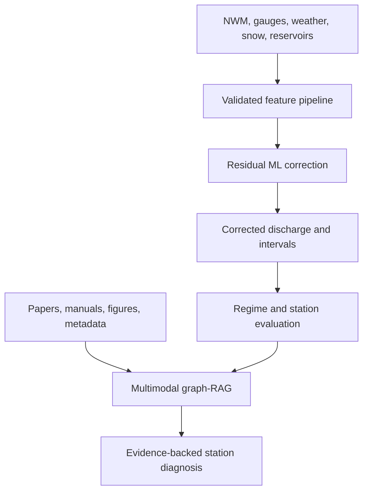

# HYDRO-FLOW-AI

HYDRO-FLOW-AI is a reproducible research platform for correcting weak National
Water Model (NWM) streamflow estimates, with special attention to gauges whose
baseline Kling-Gupta efficiency (KGE) is zero or negative. It combines:

1. **Physics-guided post-processing** that predicts residual error around an
   operational hydrologic forecast.
2. **River-network features** that encode upstream/downstream connectivity.
3. **Regime-aware evaluation** for low flow, normal flow, high flow, snowmelt,
   and regulated basins.
4. **Graph-RAG diagnostics** that connect papers, gauges, datasets, figures,
   experiments, metrics, and modelling decisions with traceable evidence.

The repository ships with a synthetic demonstration so no external credentials
or restricted data are required.

## Architecture



The forecasting graph and knowledge graph solve different problems. The former
represents flow connectivity; the latter supports retrieval, provenance, and
scientific interpretation.

## Quick start

```bash
python -m venv .venv
source .venv/bin/activate
pip install -e ".[dev,api]"

hydroflow make-demo --output data/demo.csv
hydroflow train --data data/demo.csv --output artifacts
hydroflow evaluate --data data/demo.csv --artifacts artifacts
hydroflow diagnose --artifacts artifacts --station S003
pytest
```

Start the API:

```bash
hydroflow serve --artifacts artifacts
```

Open `http://localhost:8000/docs`.

## Research guardrails

- Splits are chronological; training transformations never see test data.
- Model selection prioritizes KGE improvement without sacrificing flood-event
  detection or degrading already strong stations.
- ML predictions are non-negative and retain the NWM estimate as a fallback.
- Forecast vintages must reflect information available at issue time.
- Generated diagnostic claims must cite indexed evidence and model-run IDs.
- This is a research system, not an official warning service.

See [docs/PROJECT_PLAN.md](docs/PROJECT_PLAN.md),
[docs/KNOWLEDGE_GRAPH.md](docs/KNOWLEDGE_GRAPH.md), and
[docs/MODEL_CARD.md](docs/MODEL_CARD.md).

## Snakemake workflow

From the repository root:

```bash
snakemake --snakefile workflow/Snakefile \
  --workflow-profile workflow/profiles/local \
  --dry-run

snakemake --snakefile workflow/Snakefile \
  --workflow-profile workflow/profiles/local
```

See [workflow/README.md](workflow/README.md) before using the Slurm profile.

